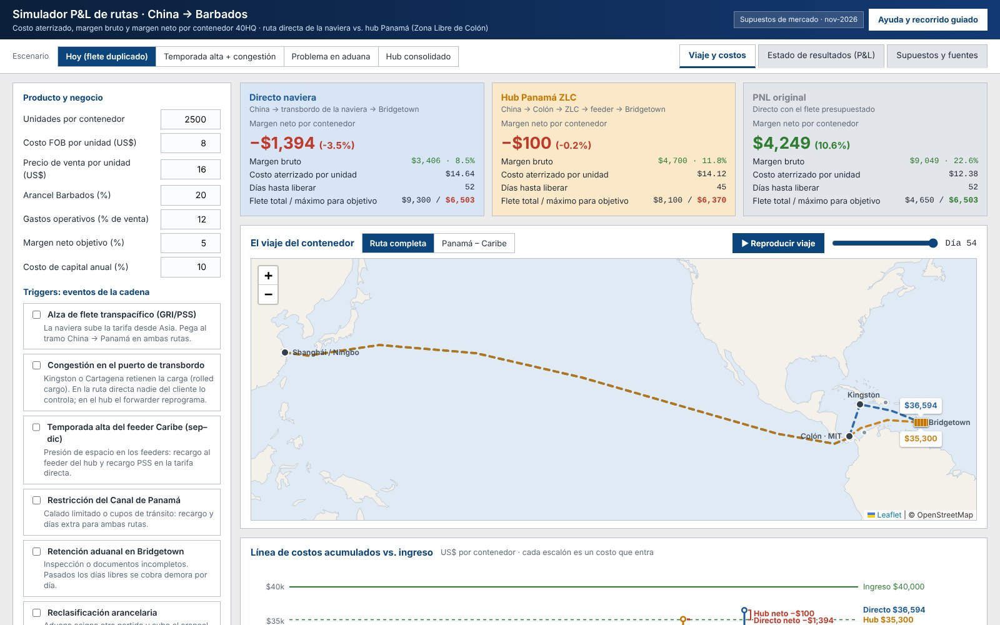

# Simulador P&L de rutas · China → Barbados

Herramienta web que compara el costo aterrizado, el margen bruto y el margen neto de un contenedor 40HQ por dos rutas:

- **Directo naviera**: China → transbordo de la naviera (Kingston, Cartagena o Caucedo) → Bridgetown, con un solo B/L de la naviera.
- **Hub Panamá ZLC**: China → Colón (MIT) → Zona Libre de Colón → feeder → Bridgetown, coordinado por un solo forwarder.

La línea gris es el **PNL original** (flete presupuestado), como referencia.

**Abrir el simulador:** https://diegobethancourth.github.io/simulador-pnl-rutas-caribe/

**Video explicativo:** [`docs/Simulador_PNL_rutas_China_Barbados.mp4`](docs/Simulador_PNL_rutas_China_Barbados.mp4)

## Qué tiene

- **Recorrido guiado**: botón *Ayuda y recorrido guiado* arriba a la derecha (se abre solo cuando el usuario lo pide).
- **Fletes y costos por ruta**: bloque en la columna izquierda para poner las cotizaciones reales de cada ruta.
- **Descargar Excel**: genera un .xlsx con el escenario de la pantalla: hoja *Supuestos* editable (celdas amarillas), *Estado de resultados* con fórmulas vivas para las tres rutas, *Sensibilidad al flete* y *Notas y fuentes*.
- **Video explicativo**: pestaña con el video narrado.
- **Viaje y costos**: mapa con las dos rutas, contenedores que avanzan día a día con su costo acumulado y la línea de costos contra el ingreso.
- **Estado de resultados (P&L)**: financieros completos de las tres rutas, con % sobre venta y diferencia Hub − Directo, por contenedor, por unidad o por año. Incluye la cascada del ingreso al margen neto.
- **Triggers**: alza de flete, congestión en el transbordo, temporada alta del feeder, restricción del Canal, retención aduanal, reclasificación arancelaria y merma.
- **Palancas**: consolidar contenedores por embarque en ZLC y tarifa negociada por volumen.

## Supuestos del modelo

- Barbados cobra arancel (CET CARICOM) y levy ambiental de 1% sobre el valor **CIF**, que incluye todo el flete y el manejo hasta Bridgetown. Por eso cada US$1 de flete cuesta ~US$1.21 en el P&L.
- El IVA de 17.5% no se incluye: es recuperable para el importador registrado.
- Referencias de nov-2026: ~US$9,100–9,550 por 40HQ China → Barbados (~52 días); US$5,000 por 40HQ Shanghái → Manzanillo, Panamá. El feeder Colón → Bridgetown y el manejo en ZLC son supuestos **por cotizar**.
- Los números del producto (2,500 unidades, FOB US$8, venta US$16) son de ejemplo.

Archivos: `index.html` (la herramienta), `export.js` (generador del Excel, usa ExcelJS en `exceljs.min.js`), `land.js` (costas para el mapa sin conexión), `leaflet.css`. El mapa usa Leaflet y OpenStreetMap.
